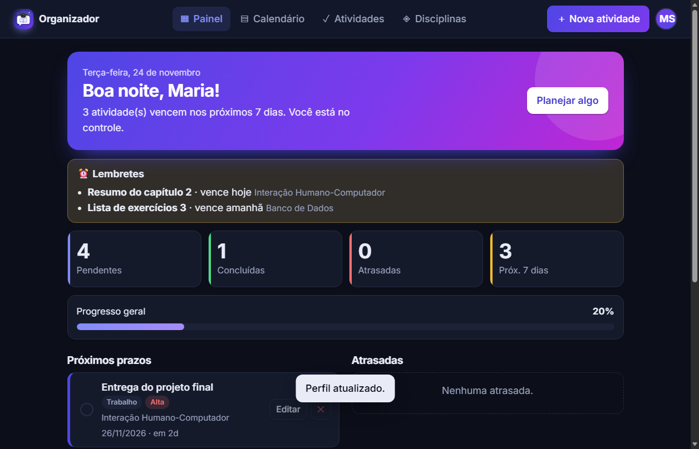
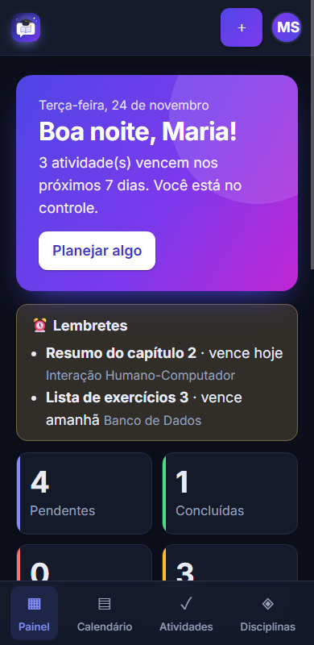

<div align="center">


# Organizador Acadêmico Inteligente

**Planeje provas, trabalhos e tarefas em um só lugar e nunca mais perca um prazo.**


[Funcionalidades](#-funcionalidades) ·
[Como executar](#-como-executar) ·
[Dados](#-onde-ficam-os-dados) ·
[Estrutura](#-estrutura-do-projeto) ·
[API](#-api-local) ·
[Documentação](#-documentação) ·
[Autoria](#-autoria)

</div>

---

Projeto Final da disciplina de **Interação Humano-Computador (IHC)**, Instituto de Informática, Universidade Federal de Goiás. Professor: Dirson S. Campos.

O sistema ajuda estudantes universitários a planejar a rotina acadêmica: cadastre disciplinas, registre provas, trabalhos e tarefas com prazo e prioridade, veja tudo em um calendário e acompanhe o que está pendente e concluído.

<div align="center">

| Painel (claro) | Painel (escuro, texto grande) | Celular |
| :---: | :---: | :---: |
|  |  |  |

</div>

## ✨ Funcionalidades

| Área | O que faz |
| --- | --- |
| **Cadastro do aluno** | Nome, curso (opcional) e tema na primeira visita; perfil editável a qualquer momento |
| **Painel** | Saudação, lembretes de hoje e amanhã, contadores, barra de progresso, próximos prazos e atrasadas |
| **Atividades** | Provas, trabalhos e tarefas com disciplina, prioridade, prazo e observações. Busca, filtros e ordem inteligente (prazo, prioridade e tipo) |
| **Disciplinas** | Cadastro com cor própria, usada em toda a interface |
| **Calendário** | Visão mensal; clicar no dia lista as atividades e pré-preenche a data |
| **Desfazer** | Excluir é imediato e um aviso oferece "Desfazer" por 7 segundos |
| **Acessibilidade** | Três tamanhos de texto, alto contraste, tema claro e escuro, uso por teclado, respeito a "reduzir movimento" |
| **Dados locais** | Persistência em arquivo no seu computador, com exportação e importação de backup em JSON |
| **Offline** | Funciona sem internet e pode ser instalado como aplicativo (PWA) |

## 🚀 Como executar

**Requisito:** [Node.js](https://nodejs.org) instalado. Não há dependências para instalar.

### Windows

Dê dois cliques em **`iniciar.bat`**. O navegador abre em <http://localhost:3000>.

### Qualquer sistema

```bash
node server.js
# ou
npm start
```

Depois acesse <http://localhost:3000>. Para usar outra porta:

```bash
PORT=3100 node server.js
```

> [!NOTE]
> Abrir o `index.html` direto no navegador também funciona, mas os dados ficam apenas no `localStorage` e o modo offline não é ativado.

## 💾 Onde ficam os dados

- Com o servidor ativo, os dados são gravados em `data/db.json` (a pasta `data/` não é versionada).
- O `localStorage` do navegador guarda uma cópia de reserva. Se o servidor cair, o app continua e avisa.
- No perfil, use **Exportar backup** e **Importar backup** para guardar ou restaurar um arquivo JSON.

## 📁 Estrutura do projeto

```text
.
├── index.html               estrutura das telas e diálogos
├── css/
│   └── style.css            visual, temas, transições, responsividade, alto contraste
├── js/
│   └── app.js               lógica: estado, telas, persistência, perfil, desfazer, lembretes
├── public/
│   └── logo.svg             logo e ícone
├── docs/
│   ├── relatorio.html       fonte do relatório de apoio à apresentação
│   └── img/                 capturas de tela
├── server.js                servidor local sem dependências (arquivos estáticos e API)
├── sw.js                    service worker (modo offline)
├── manifest.webmanifest     instalação como aplicativo
├── iniciar.bat              atalho para iniciar no Windows
├── package.json
├── relatorio.pdf            relatório de apoio à apresentação
└── registro.md              transcrição dos pedidos e respostas do desenvolvimento
```

## 🔌 API local

O servidor escuta somente em `127.0.0.1` e serve apenas `index.html`, `css/`, `js/`, `public/`, `sw.js` e `manifest.webmanifest`.

| Método | Rota | Descrição |
| :---: | --- | --- |
| `GET` | `/api/dados` | Retorna os dados salvos (404 se ainda não houver) |
| `PUT` | `/api/dados` | Grava os dados (JSON com `disciplinas` e `atividades`; valida o formato) |

## 🧰 Tecnologias

- HTML, CSS e JavaScript puros, sem frameworks
- Node.js com módulos nativos (`http`, `fs` e `path`)
- Service Worker e Web App Manifest

## 📚 Documentação

- 📄 [`relatorio.pdf`](relatorio.pdf): decisões de design, heurísticas de Nielsen, acessibilidade com contrastes medidos, protocolo de teste de usabilidade com SUS, roteiro de slides e perguntas da banca
- 📝 [`registro.md`](registro.md): registro de cada pedido e resposta ao longo do desenvolvimento

## ⚠️ Limitações conhecidas

- Uso pessoal: sem contas de usuário nem sincronização entre dispositivos
- Notificações funcionam apenas com o navegador aberto
- Testado em Edge (Chromium); Lighthouse, leitor de tela e teste de usabilidade com pessoas ainda não foram realizados

## 👥 Autoria

| Integrantes |
| --- |
| Eduardo de Brito |
| Rian Santana |
| Marcos Paulo Caetano |

Disciplina de IHC, Prof. Dirson S. Campos, UFG.
