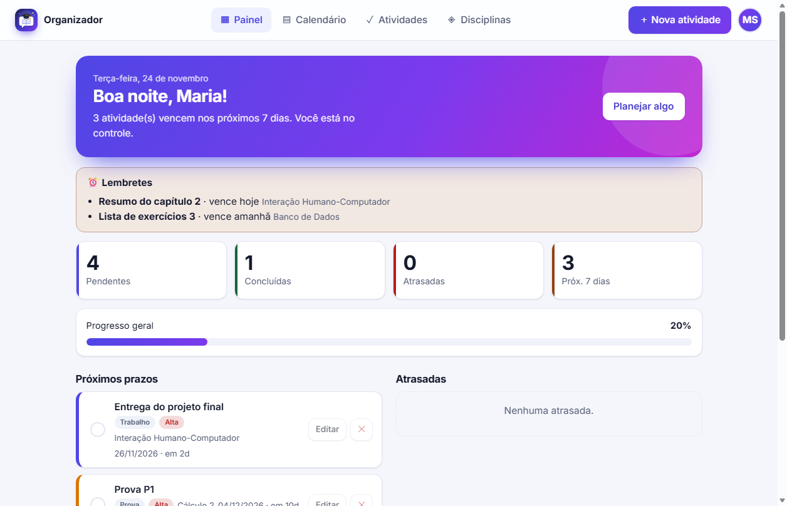

# Organizador Acadêmico Inteligente

Aplicação web de organização acadêmica para estudantes universitários, desenvolvida como Projeto Final da disciplina de Interação Humano-Computador (IHC), Instituto de Informática, Universidade Federal de Goiás.

Cadastre disciplinas, registre provas, trabalhos e tarefas com prazo e prioridade, veja tudo em um calendário e acompanhe o que está pendente e concluído. O objetivo é ajudar o estudante a planejar a rotina e não esquecer prazos.



## Funcionalidades

- **Cadastro do aluno:** nome, curso (opcional) e tema na primeira visita; perfil editável.
- **Painel:** saudação, lembretes de hoje e amanhã, contadores, barra de progresso, próximos prazos e atrasadas.
- **Atividades:** provas, trabalhos e tarefas com disciplina, prioridade, prazo e observações. Busca, filtros e ordem inteligente (prazo, prioridade e tipo).
- **Disciplinas:** cadastro com cor própria, usada em toda a interface.
- **Calendário:** visão mensal; clicar no dia lista as atividades e pré-preenche a data.
- **Desfazer:** excluir é imediato e um aviso oferece "Desfazer" por 7 segundos.
- **Acessibilidade:** três tamanhos de texto, alto contraste, tema claro e escuro, uso por teclado, respeito a "reduzir movimento".
- **Dados seus, no seu computador:** persistência em arquivo local, com exportação e importação de backup em JSON.
- **Offline:** funciona sem internet e pode ser instalado como aplicativo (PWA).

## Como executar

Requisito: [Node.js](https://nodejs.org) instalado. Não há dependências para instalar.

**Windows:** dê dois cliques em `iniciar.bat`. O navegador abre em http://localhost:3000.

**Qualquer sistema:**

```bash
node server.js
# ou
npm start
```

Depois acesse http://localhost:3000. Para usar outra porta: `PORT=3100 node server.js`.

> Abrir o `index.html` direto no navegador também funciona, mas os dados ficam apenas no `localStorage` e o modo offline não é ativado.

## Onde ficam os dados

- Com o servidor ativo, os dados são gravados em `data/db.json` (a pasta `data/` não é versionada).
- O `localStorage` do navegador guarda uma cópia de reserva. Se o servidor cair, o app continua e avisa.
- No perfil, use **Exportar backup** e **Importar backup** para guardar ou restaurar um arquivo JSON.

## Estrutura

```
index.html               estrutura das telas e diálogos
css/style.css            visual, temas, transições, responsividade, alto contraste
js/app.js                lógica: estado, telas, persistência, perfil, desfazer, lembretes
server.js                servidor local sem dependências (arquivos estáticos e API)
sw.js, manifest.webmanifest   modo offline e instalação como aplicativo
public/logo.svg          logo e ícone
docs/relatorio.html      fonte do relatório de apoio à apresentação
docs/img/                capturas de tela
relatorio.pdf            relatório de apoio à apresentação
registro.md              transcrição dos pedidos e respostas do desenvolvimento
iniciar.bat              atalho para iniciar no Windows
```

## API local

O servidor escuta somente em `127.0.0.1` e serve apenas `index.html`, `css/`, `js/`, `public/`, `sw.js` e `manifest.webmanifest`.

| Método | Rota | Descrição |
| --- | --- | --- |
| GET | `/api/dados` | Retorna os dados salvos (404 se ainda não houver) |
| PUT | `/api/dados` | Grava os dados (JSON com `disciplinas` e `atividades`; valida o formato) |

## Tecnologias

HTML, CSS e JavaScript puros, sem frameworks. Node.js (módulos nativos `http`, `fs` e `path`). Service worker e Web App Manifest.

## Documentação

- [`relatorio.pdf`](relatorio.pdf): decisões de design, heurísticas de Nielsen, acessibilidade com contrastes medidos, protocolo de teste de usabilidade com SUS, roteiro de slides e perguntas da banca.
- [`registro.md`](registro.md): registro de cada pedido e resposta ao longo do desenvolvimento.

## Limitações conhecidas

- Uso pessoal: sem contas de usuário nem sincronização entre dispositivos.
- Notificações funcionam apenas com o navegador aberto.
- Testado em Edge (Chromium); Lighthouse, leitor de tela e teste de usabilidade com pessoas ainda não foram realizados.

## Autoria

Integrantes:
- Eduardo de Brito
- Rian Santana
- Marcos Paulo Caetano
Disciplina de IHC, Prof. Dirson S. Campos, UFG.
